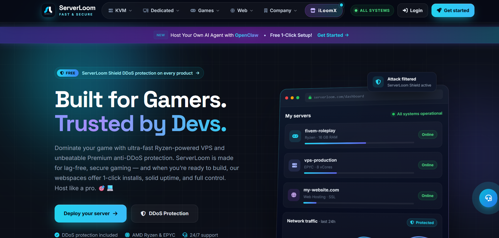
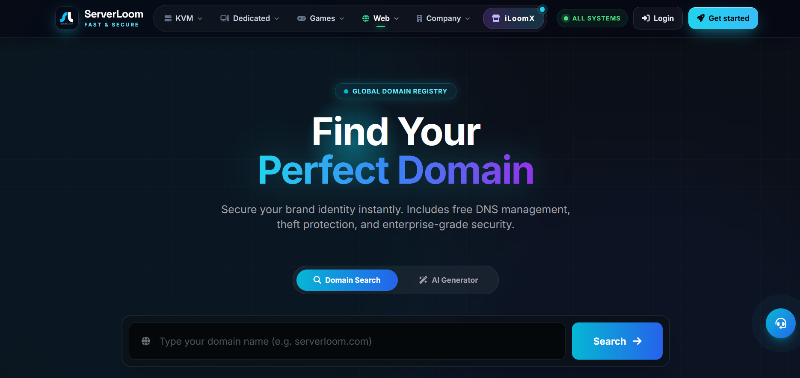
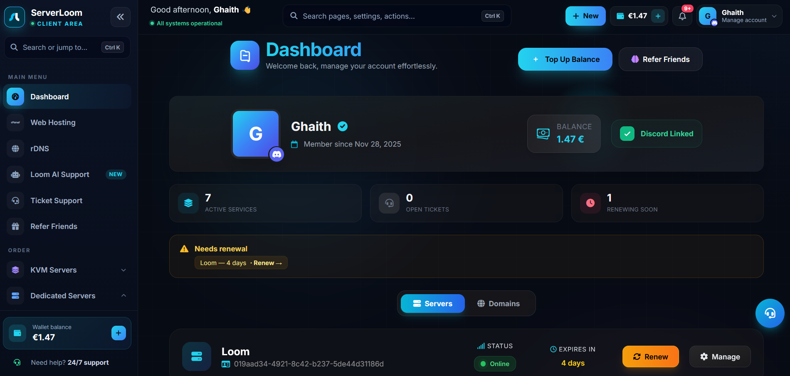
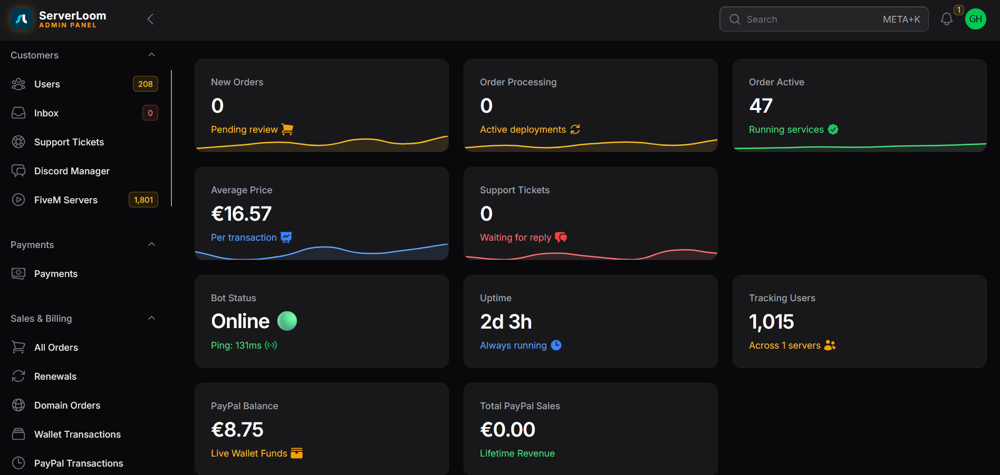
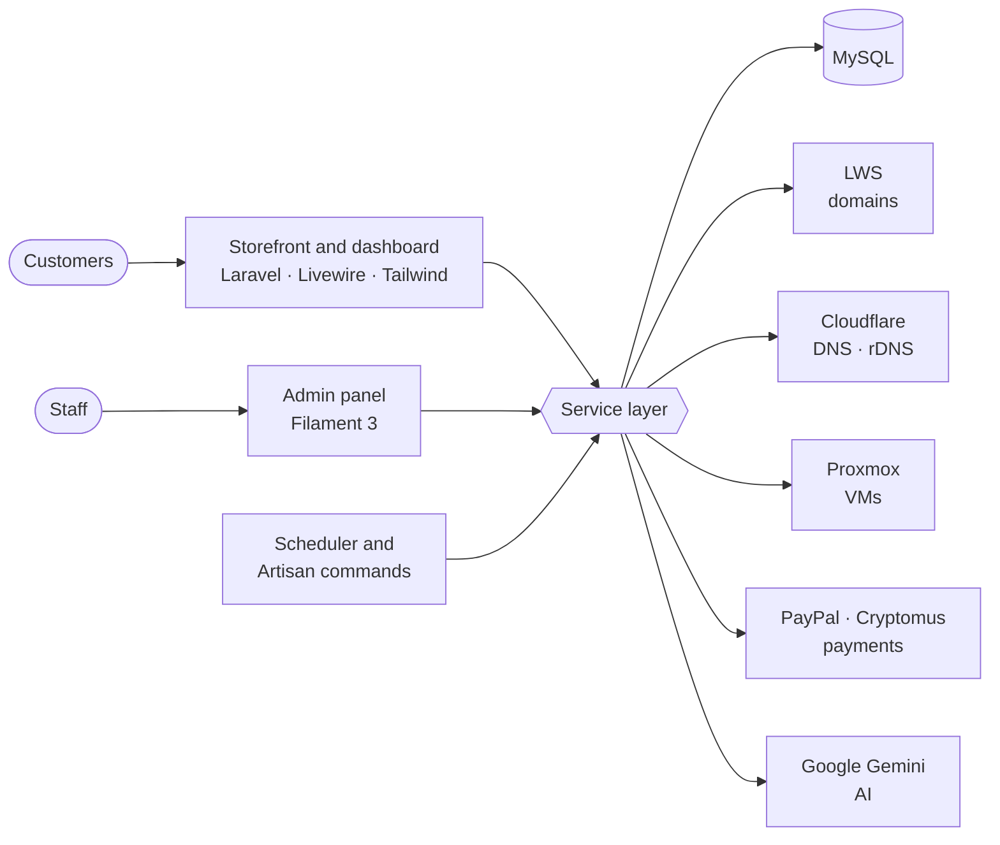

  

<h1 align="center">ServerLoom</h1>

<b>Hosting, domains and billing automation platform</b> Designed, built and operated end to end by <a href="https://github.com/M3kanoDev">@M3kanoDev</a>

  
  
  

  
  
  
  
  
  
  
  

> [!NOTE]
> ServerLoom is a commercial product, so its source code is private. This repository documents what it does and how it's built.
> **Want a walkthrough or a similar platform for your business?** Email [M3kano@serverloom.com](mailto:M3kano@serverloom.com).

---

## What it is

ServerLoom is a complete platform for running a hosting company. Customers search and register domains, order VPS and web hosting, pay from a prepaid wallet and get help from an AI assistant. Staff run everything from one admin panel.

Every part of it was built by one developer: the storefront, the customer dashboard, the admin panel, the billing engine and all the third-party integrations.

  
  
  
  

---

## Highlights

| | |
|---|---|
| 🌐 **Domain registrar** | Real-time availability search, 300+ TLDs, AI name suggestions, DNS and nameserver management, transfer locks and auth codes |
| 🖥️ **Server ordering** | Configure and order KVM VPS (Ryzen and EPYC), dedicated servers, cPanel hosting, Nextcloud hosting and DDoS protection |
| ⚙️ **Infrastructure automation** | Proxmox API for VM status and reboots, Cloudflare API for DNS and reverse DNS (PTR) with proxy toggle |
| 💳 **Wallet and billing** | Cents-precise prepaid wallet, PayPal and crypto payments with webhooks, offline methods, vouchers, PDF invoices |
| 🤖 **Loom AI assistant** | Gemini-powered support that knows the customer's active services: FiveM, Minecraft, cPanel, WordPress, Docker, Linux hardening |
| 🎯 **Affiliate program** | Referral links, click and signup tracking, automatic commissions, admin payouts |
| 🛠️ **Admin panel** | Filament 3 backend: clients with impersonation, orders, payments, catalog, revenue charts, logs, backups, 2FA |
| 🎫 **Support desk** | Ticket system with IMAP email import, Discord webhook alerts and email templates |

---

## Architecture

Each integration lives in its own service class (domains, DNS, virtualization, payments, AI), so controllers, Livewire components and admin resources share one tested code path.

**Automation jobs**
- Domain price import with per-TLD profit margins
- Hosting expiration checks and suspension
- Support inbox sync over IMAP
- Automated backups

---

## Tech stack

**Backend:** Laravel 10, PHP 8.1+, MySQL 8, Filament 3, Livewire 3
**Frontend:** Blade, Tailwind CSS 3.4 (custom dark and neon theme), Alpine.js, Preline UI, Vite
**Packages:** Bavix Wallet, Spatie Backup, Spatie Media Library, DomPDF, Laravel Socialite (Discord login), Laravel IMAP, Laravel Trend
**APIs:** LWS, Cloudflare, Proxmox, PayPal, Cryptomus, Google Gemini

---

## Security

- Two-factor authentication for staff accounts
- Email verification for new customers
- Signed and verified payment webhooks
- Encrypted sessions, CSRF protection and enforced password rules
- Logged API key usage and automated off-site backups

---

## Author

Built by **Soltani Ghaith** ([@M3kanoDev](https://github.com/M3kanoDev)), founder of ServerLoom and iLoomX.

[serverloom.com](https://serverloom.com) · [iloomx.com](https://iloomx.com) · [More of my work](https://iloomx.com/preview) · [M3kano@serverloom.com](mailto:M3kano@serverloom.com)

© ServerLoom. All rights reserved. Screenshots are shown for portfolio purposes.
